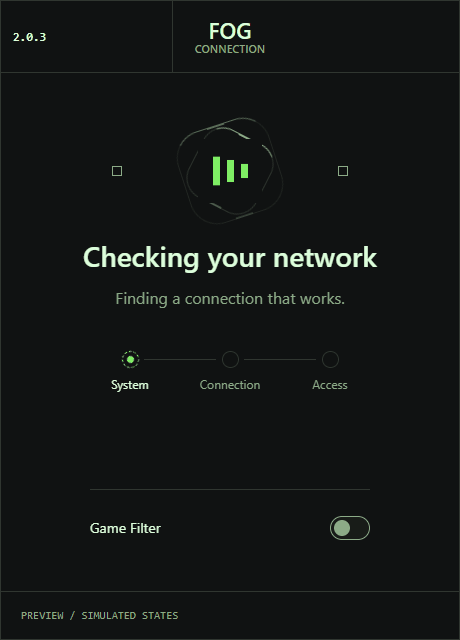
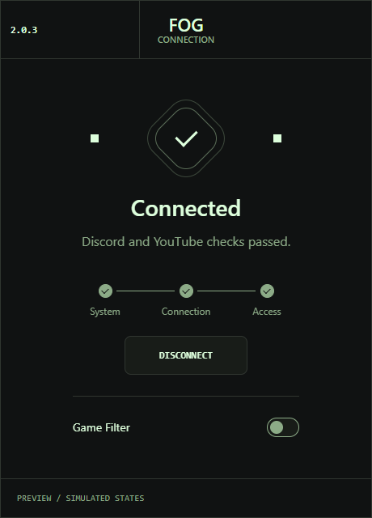

<div align="center">

# FOG Prime

### Open. Connect. Get back to what matters.

A focused Windows utility for Discord and YouTube connectivity.<br />
Automatic profiles. Local diagnostics. One quiet interface.

[](https://github.com/DenisRapira/FOG-Prime/releases/latest) [](https://denisrapira.github.io/FOG-Prime/)

[](https://github.com/DenisRapira/FOG-Prime/actions/workflows/ci.yml) [](https://github.com/DenisRapira/FOG-Prime/actions/workflows/codeql.yml) [](https://github.com/DenisRapira/FOG-Prime/actions/workflows/secrets.yml) [](https://github.com/DenisRapira/FOG-Prime/releases) [](LICENSE)

[Quick Start](#quick-start) &nbsp; / &nbsp; [Features](#features) &nbsp; / &nbsp; [How It Works](#how-it-works) &nbsp; / &nbsp; [Documentation](#documentation)



<sub>Actual UI layout with simulated states and English preview labels.<br />The released app currently uses Russian labels. Not a connection-speed benchmark.</sub>

<details>
<summary>Prefer a still image?</summary>
<br />

</details>

</div>

---

## Less Setup. More Connection.

FOG Prime selects from bundled network profiles, checks access, and remembers
what worked for your network. You see the connection state, not a wall of
strategies and command-line switches.

It runs on your PC, without a FOG account, subscription, or FOG-operated server.
Connectivity probes and update checks contact external services as described in
the [privacy policy](docs/PRIVACY.md).

> [!NOTE]
> This is a local networking utility, not a hosted VPN or proxy service.
> It cannot guarantee access on every provider or repair server-side lag, NAT,
> or every voice-chat problem.

## Quick Start

1. Download **[FOG-Prime-2.0.3-win-x64.zip](https://github.com/DenisRapira/FOG-Prime/releases/download/v2.0.3/FOG-Prime-2.0.3-win-x64.zip)** from the official release.
2. Close any older FOG instance. Extract the ZIP into a **new folder**.
3. Run **`FOG Prime.exe`**, approve the Windows elevation prompt, and let FOG check the connection.

Keep `app/` and `notices/` next to the launcher. Do not run backend executables
separately or move the launcher out of its folder. Dependency source archives
are provided for license compliance; **you do not need them to run FOG**.

| You Need | Included / Required |
| :--- | :--- |
| Windows | Windows 10 or 11, x64 |
| .NET 10 | Included in the portable package |
| WebView2 | Microsoft Edge WebView2 Runtime must be installed |
| Permissions | Administrator access; Windows Base Filtering Engine available |
| Installation | Extract the official ZIP; no installer required |

<details>
<summary><strong>Verify your download</strong></summary>

Download the [SHA-256 file](https://github.com/DenisRapira/FOG-Prime/releases/download/v2.0.3/FOG-Prime-2.0.3-win-x64.sha256) and compare it with:

```powershell
Get-FileHash .\FOG-Prime-2.0.3-win-x64.zip -Algorithm SHA256
```

Expected SHA-256 for the published 2.0.3 ZIP:

```text
daca6de1372939b021814692a6ab713c205bd1f00b8bf176d340626828fd4fad
```

Archive size: **96,579,182 bytes** (about 92.1 MiB). A checksum helps detect
corruption or replacement; it is not an independent publisher signature.

</details>

## Features

| Capability | What It Does |
| :--- | :--- |
| **Automatic profile selection** | Tries a small bundled set of profiles instead of asking you to choose strategies. |
| **Network-aware memory** | Remembers working profiles separately for different network/mode contexts. |
| **Connection recovery** | Supervises the Engine, retries failures, and rejects obsolete check results after network changes. |
| **Clear connection stages** | Shows System, Connection, and Access states driven by the Agent, without invented percentages. |
| **Manual Game Filter** | One saved switch for additional destination-based game rules; no game catalog in the app window. |
| **Quieter background work** | Adaptive checks, cached snapshots, fewer redraws, and best-effort WebView2 suspension when minimized. |
| **Clean shutdown** | Closing the window stops FOG-owned Agent and Engine processes. Minimizing keeps the connection running. |
| **Update notifications** | Offers the official GitHub release page; no hidden automatic installation. |

### Service Coverage

| Service | Current Scope | Important Boundary |
| :--- | :--- | :--- |
| **Discord** | Profiles, HTTPS/Gateway probes, and recent local connection-state evidence when available. | A passed check is not proof of working two-way audio. |
| **YouTube** | Connection profiles and endpoint/CDN checks. | Not an end-to-end playback or bandwidth benchmark. |
| **Games** | Optional rules; the internal catalog includes ROB RUN and Warframe. | Destination-based, not process-based; not every server or chat path is covered. |
| **Telegram / Steam** | Not target services in this release. | No compatibility claim. |

Game Filter is **off by default**. Changing it reconnects FOG, not your game.
Other apps using the same destination networks can also be affected. FOG does
not reset system DNS, disable your VPN, or restart games. Opening Discord or a
game does not automatically launch FOG.

## What's New in 2.0.3

- Animated connection contours and real progress stages; continuous motion stops after success or failure.
- Reduced-motion support and paused hidden-interface animation.
- Improved Start/Stop ordering and cancellation after network changes.
- Per-network profile memory and lower idle polling.
- A single launcher with its own icon; Agent and Engine live under `app/`.
- Stronger runtime integrity checks, local IPC controls, and bounded update requests.

[Full Release Notes](docs/RELEASE-2.0.3.md) &nbsp; / &nbsp; [Changelog](CHANGELOG.md) &nbsp; / &nbsp; [Previous Release](https://github.com/DenisRapira/FOG-Prime/releases/tag/v2.0.2)

## How It Works

```text
FOG Prime.exe              One clear connection state
      |
      | authenticated, current-user local named pipe
      v
app/FOG.Agent.exe          Profiles / checks / recovery / integrity
      |
      | direct process launch, no shell scripts
      v
app/runtime/FOG.Engine.exe + WinDivert
                          Selected network traffic processing
```

The Agent accepts a fixed command set and verifies trusted manifests and runtime
hashes before launch. The UI does not receive raw Engine arguments.
See [Architecture](ARCHITECTURE.md) for the actual trust boundaries.

## Security & Privacy

| Safeguard | Implementation |
| :--- | :--- |
| Local control channel | Current-user named pipe, random per-session token, and request limits. |
| Package integrity | SHA-256 verification; verified files and ancestor directories stay pinned during Agent operation. |
| Path handling | Reparse-point package/runtime paths are rejected. |
| Updates | Restricted GitHub release URLs, bounded responses, no automatic installation. |
| Source checks | Managed tests, CodeQL, dependency advisories, and redacted Git-history secret scanning. |
| Data handling | No built-in analytics uploader identified in reviewed UI/Agent sources; external probes and local diagnostics are documented. |

> [!IMPORTANT]
> Application EXEs are not Authenticode-signed. The original driver's signature
> does not sign FOG itself. The current UI also runs elevated; this remains a
> security boundary to improve. No antivirus-clean, anti-cheat-safe, anonymity,
> or universal-compatibility guarantee is made.

Never post tokens, private keys, personal paths, or unredacted logs in issues.
Use [private vulnerability reporting](https://github.com/DenisRapira/FOG-Prime/security/advisories/new)
for sensitive reports. Read the [Security Policy](SECURITY.md) and
[Privacy Policy](docs/PRIVACY.md).

<details>
<summary><strong>What has actually been verified?</strong></summary>

- **108/108** scoped managed tests.
- UI checks at **three window sizes**, including reduced motion and hidden states.
- Package-tamper rejection, authenticated IPC, and process-lifecycle checks.
- **Eight** native argument dry runs; these do not load the driver.
- Real WebView2 minimize, restore, and close checks.
- The published ZIP was downloaded again and matched its SHA-256.
- The user reported successful local operation and approved publication.

This is not a multi-provider, long-session, game, voice-audio, or anti-cheat
certification. Full native-code review and disposable-VM driver testing remain
incomplete. No files were uploaded to VirusTotal. Accepted runtime bytes and
their original provenance are preserved; see
[Release Acceptance](docs/RELEASE-ACCEPTANCE-2.0.3.md).

</details>

## Build From Source

Use the .NET SDK selected by `global.json`:

```powershell
dotnet restore .\FOG.Prime.sln --locked-mode
dotnet build .\FOG.Prime.sln -c Release --no-restore
.\build\verify-repository.ps1 -SkipBuild
```

**Stack:** C# / .NET 10 / WPF / WebView2 / native C / PowerShell.
Native Engine builds require the Cygwin packages and pinned static-link
dependencies in the [Build Guide](docs/BUILDING.md). Building the managed
solution alone does not create a complete distribution. Byte-for-byte
reproducibility is not claimed.

## Need a Hand?

| Situation | Start Here |
| :--- | :--- |
| The window does not open | Install or repair Microsoft Edge WebView2 Runtime. |
| Windows asks for administrator access | Expected: the network driver requires elevation. |
| An integrity check fails | Download the official ZIP again and extract all files into a new folder. |
| Checks fail with a VPN | Read the troubleshooting guide; FOG does not change your VPN settings. |
| Connectivity stops after closing FOG | Expected: closing stops the portable application's backend. |

[Troubleshooting](docs/TROUBLESHOOTING.md) &nbsp; / &nbsp; [Support](SUPPORT.md) &nbsp; / &nbsp; [Report a Bug](https://github.com/DenisRapira/FOG-Prime/issues)

## Documentation

| Product & Usage | Development & Trust |
| :--- | :--- |
| [Website](https://denisrapira.github.io/FOG-Prime/) | [Architecture](ARCHITECTURE.md) |
| [Release Notes](docs/RELEASE-2.0.3.md) | [Build Guide](docs/BUILDING.md) |
| [Changelog](CHANGELOG.md) | [Contributing](CONTRIBUTING.md) |
| [Troubleshooting](docs/TROUBLESHOOTING.md) | [Patch Checklist](docs/PATCH-CHECKLIST.md) |
| [Privacy Policy](docs/PRIVACY.md) | [Security Review](docs/SECURITY-REVIEW-2.0.3.md) |
| [Release Status](docs/release-status.json) | [Dependency Sources](docs/DEPENDENCY-SOURCES-2.0.3.md) |

## Contributing & License

Bug reports, reproducible diagnostics with private data removed, documentation
improvements, and focused pull requests are welcome. Please read
[Contributing](CONTRIBUTING.md) before opening a PR.

Original FOG Prime code is **[MIT-licensed](LICENSE)**, copyright (c) 2026
**DenisRapira**. Engine, WinDivert, Cygwin, and Microsoft components retain their
respective terms. See [Third-Party Notices](THIRD_PARTY_NOTICES.md) and the
[Distribution Checklist](docs/LICENSE-COMPLIANCE.md).

---

<div align="center">

**FOG Prime** &nbsp; / &nbsp; Built for a quieter connection experience.

[Download](https://github.com/DenisRapira/FOG-Prime/releases/latest) &nbsp; / &nbsp; [Website](https://denisrapira.github.io/FOG-Prime/) &nbsp; / &nbsp; [Source](https://github.com/DenisRapira/FOG-Prime)

</div>
