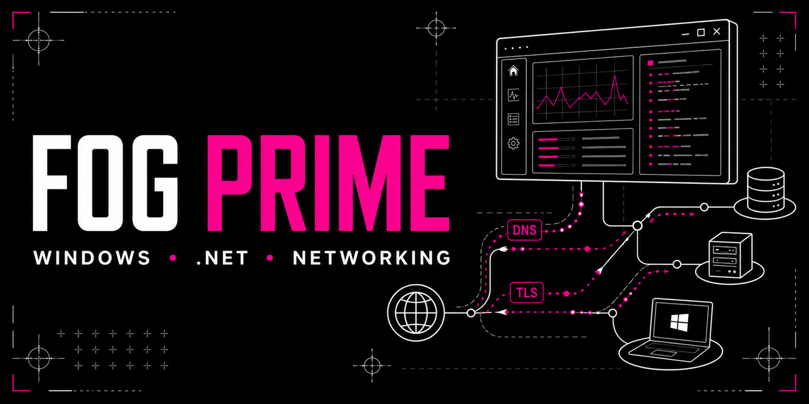

<div align="center">
  

  # FOG Prime

  **Educational Windows network diagnostics and trusted local Agent/Engine architecture built with .NET 8.**

  [](https://github.com/DenisRapira/FOG-Prime/actions/workflows/ci.yml)
  [](https://github.com/DenisRapira/FOG-Prime/actions/workflows/codeql.yml)
  [](https://github.com/DenisRapira/FOG-Prime/releases/latest)
  [](https://github.com/DenisRapira/FOG-Prime/releases)
  [](#system-requirements)
  [](https://dotnet.microsoft.com/)
  [](LICENSE)
  [](#security-and-privacy)
</div>

**FOG Prime** is an open-source educational Windows application for exploring network diagnostics, automatic connection profiles, and secure local process supervision. It checks DNS, certificate-validated TLS, QUIC and endpoint availability, selects a constrained local profile, verifies the result, and keeps the native networking engine healthy without requiring a remote server or telemetry.

**FOG Prime** - образовательное open-source приложение для Windows 10/11, демонстрирующее сетевую диагностику, автоматический выбор профиля и доверенную локальную архитектуру UI / Agent / Engine. Интерфейс проводит пользователя через три понятных этапа: проверка системы, настройка соединения и финальная проверка доступности.

> [!IMPORTANT]
> FOG Prime is a local networking utility and reference implementation. It does not provide a hosted VPN, proxy endpoint, account, subscription, anonymity guarantee, or endpoint-security product.

## Download

### FOG Prime 2.0.0

Новая версия для автоматической настройки доступа к **Discord и YouTube**:

- автоматический перебор с возвратом к лучшему найденному профилю;
- отдельный учёт ошибок голосового соединения Discord;
- быстрый повторный запуск с запоминанием проверенного профиля;
- первая проверка сразу после запуска движка, без ожидания фонового таймера;
- обновлённый интерфейс с анимацией соединения и восстановлением WebView2;
- предупреждение о VPN без его принудительного отключения.

**[Скачать v2.0.0](https://github.com/DenisRapira/FOG-Prime/releases/tag/v2.0.0)** ·
[Что изменилось](docs/RELEASE-2.0.0.md) ·
[Предыдущая v0.1.9](https://github.com/DenisRapira/FOG-Prime/releases/tag/v0.1.9)

Результат зависит от сети. Проверки доступности не гарантируют слышимость голоса,
воспроизведение видео или совместимость с каждым античитом. Telegram и Steam
не входят в целевые сервисы этой версии.

Download the current Windows x64 package from **[GitHub Releases](https://github.com/DenisRapira/FOG-Prime/releases/latest)**.

1. Download `FOG-Prime-<version>-win-x64.zip` or the current Windows x64 archive.
2. Extract the complete archive to a dedicated folder.
3. Run `FOG Prime.exe` and accept the Windows elevation prompt.
4. Keep the FOG Prime window open while the connection profile is needed.

Only use packages published under this repository's Releases page. Do not run individual files from the `runtime` directory or download builds from comments, direct messages, or third-party mirrors.

## Key features

- Automatic selection from a small, audited set of network profiles.
- Configured endpoint, CDN, transport and real-time connectivity checks.
- Certificate-validated TLS and Gateway HELLO/heartbeat checks.
- DNS diagnostics without forcing a permanent system DNS change.
- Native Windows Agent with engine supervision and automatic recovery.
- Authenticated, current-user-only named-pipe IPC with a fixed command protocol.
- SHA-256 integrity verification for every packaged runtime file.
- FOG Engine source and packet sample provenance pinned to recorded revisions.
- No mandatory cloud service, user account, analytics, or built-in telemetry.
- Portable lifecycle: closing the UI also shuts down the Agent and Engine.

## How it works

```text
FOG Prime.exe
      | authenticated local named pipe
      v
FOG.Agent.exe -- integrity, profiles, health checks, recovery
      | direct process start
      v
FOG.Engine.exe + WinDivert
```

The UI never receives raw engine arguments and never launches shell scripts. The Agent accepts only a fixed set of commands, validates trusted manifests and hashes, and starts one of the bundled profiles through a direct process API. See [ARCHITECTURE.md](ARCHITECTURE.md) for the trust boundaries and process lifecycle.

## System requirements

| Requirement | Supported configuration |
| --- | --- |
| Operating system | Windows 10 or Windows 11 x64 |
| Runtime | Microsoft Edge WebView2 Runtime |
| Permissions | Administrator access for the network driver |
| Windows service | Base Filtering Engine must be available |
| Package format | Portable ZIP from GitHub Releases |

## Security and privacy

FOG Prime runs locally and does not require a hosted backend. The UI-to-Agent channel uses a random 256-bit session token and a named pipe restricted to the current Windows user. Runtime manifests and files are verified before launch, and GitHub Actions builds release packages from source.

- Report vulnerabilities privately through [GitHub Security Advisories](https://github.com/DenisRapira/FOG-Prime/security/advisories/new).
- Remove tokens, private domains, IP addresses and personal data before posting logs.
- Read [SECURITY.md](SECURITY.md) and the [privacy policy](docs/PRIVACY.md).

## Build from source

The application uses .NET 8, C#, WPF/WebView2, C, PowerShell, WinDivert, TLS and QUIC networking components.

```powershell
dotnet restore .\FOG.Prime.sln --locked-mode
dotnet build .\FOG.Prime.sln -c Release --no-restore
.\build\verify-repository.ps1 -SkipBuild
```

Building the native Engine requires Cygwin x64 with `gcc-core`, `make`, and `zlib-devel`. Full reproducible build, packaging, integrity verification and integration-test instructions are in [docs/BUILDING.md](docs/BUILDING.md).

## Troubleshooting

- **The app requests administrator access:** WinDivert needs elevation to inspect and redirect the selected network traffic.
- **The UI does not open:** install or repair Microsoft Edge WebView2 Runtime.
- **A connectivity check still fails:** close conflicting VPN or packet-filtering tools, verify Windows Base Filtering Engine, then run the check again.
- **The package reports an integrity error:** download a fresh archive from Releases and extract all files together.
- **The connection stops after closing FOG Prime:** this is expected; the portable UI owns the Agent and Engine lifecycle.

See [docs/TROUBLESHOOTING.md](docs/TROUBLESHOOTING.md) before opening an issue.

## Frequently asked questions

### Is FOG Prime a VPN or proxy service?

No. FOG Prime is a local Windows networking tool. It does not provide a remote VPN endpoint, hosted proxy, account, or subscription.

### Does FOG Prime collect analytics or browsing history?

No built-in telemetry is included. Health checks contact only the configured public endpoints needed to verify the selected profile.

### Does it support macOS, Linux, Android or iOS?

The current release targets Windows 10/11 x64 because it depends on WinDivert and a Windows Agent. Other platforms are not currently supported.

### Where can I verify the latest version?

Use the [latest GitHub Release](https://github.com/DenisRapira/FOG-Prime/releases/latest), review its SHA-256 checksum when provided, and compare changes in [CHANGELOG.md](CHANGELOG.md).

## Project documentation

- [Architecture](ARCHITECTURE.md)
- [Build guide](docs/BUILDING.md)
- [Troubleshooting](docs/TROUBLESHOOTING.md)
- [Security policy](SECURITY.md)
- [Privacy policy](docs/PRIVACY.md)
- [Contributing](CONTRIBUTING.md)
- [Support](SUPPORT.md)
- [Changelog](CHANGELOG.md)
- [Third-party notices](THIRD_PARTY_NOTICES.md)

## Contributing and license

Issues and pull requests are welcome under the rules in [CONTRIBUTING.md](CONTRIBUTING.md). FOG Prime source code is licensed under the [MIT License](LICENSE). FOG Engine and WinDivert include separate upstream licenses and notices documented in [THIRD_PARTY_NOTICES.md](THIRD_PARTY_NOTICES.md) and [FOG.Engine/UPSTREAM.md](FOG.Engine/UPSTREAM.md).

Project website: **[denisrapira.github.io/FOG-Prime](https://denisrapira.github.io/FOG-Prime/)**
