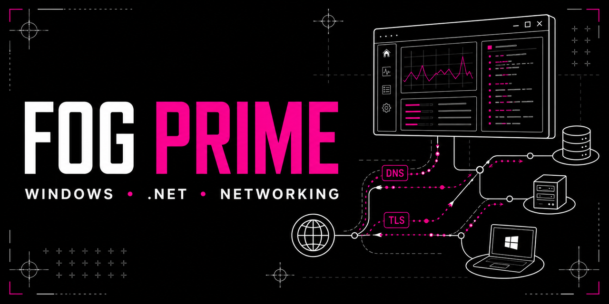

<div align="center">
  

  # FOG Prime

  **Windows network diagnostics with automatic connection profiles. FOG Prime 2.0.3 is available for Windows x64 with .NET 10 included.**

  [](https://github.com/DenisRapira/FOG-Prime/actions/workflows/ci.yml)
  [](https://github.com/DenisRapira/FOG-Prime/actions/workflows/codeql.yml)
  [](https://github.com/DenisRapira/FOG-Prime/releases/latest)
  [](https://github.com/DenisRapira/FOG-Prime/releases)
  [](#system-requirements)
  [](https://dotnet.microsoft.com/)
  [](LICENSE)
  [](#security-and-privacy)
</div>

**FOG Prime** is an open-source educational Windows application for exploring network diagnostics, automatic connection profiles, and local process supervision. Its current checks cover DNS, certificate-validated HTTPS and a synthetic Discord Gateway WebSocket session. Engine profiles also contain QUIC/UDP rules; those rules are not an end-to-end QUIC or voice test. No FOG-operated backend is required, but probes and update checks contact third parties; see [Privacy](docs/PRIVACY.md).

**FOG Prime** - образовательное open-source приложение для Windows 10/11, демонстрирующее сетевую диагностику, автоматический выбор профиля и доверенную локальную архитектуру UI / Agent / Engine. Подключение запускается автоматически, интерфейс показывает один понятный статус.

> [!IMPORTANT]
> FOG Prime is a local networking utility and reference implementation. It does not provide a hosted VPN, proxy endpoint, account, subscription, anonymity guarantee, or endpoint-security product.

## Download

### FOG Prime 2.0.3

**[Скачать v2.0.3 для Windows x64](https://github.com/DenisRapira/FOG-Prime/releases/tag/v2.0.3)** ·
[Что изменилось](docs/RELEASE-2.0.3.ru.md) ·
[Предыдущая v2.0.2](https://github.com/DenisRapira/FOG-Prime/releases/tag/v2.0.2)

Версия **2.0.3** опубликована. В релизе:

- реальные этапы подключения с анимацией и спокойным состоянием после успеха;
- меньше фоновых опросов, приостановка интерфейса при сворачивании;
- отмена устаревших проверок при смене сети и память профилей для разных сетей;
- ручной игровой фильтр, без списка игр и технических настроек в окне;
- иконка основного EXE; Agent и Engine находятся в папке `app/`;
- усиленная проверка целостности, защита IPC и безопасные ссылки обновлений.

Подключение к **Discord и YouTube** запускается автоматически. При длительном
сбое доступна кнопка «Повторить». Закрытие окна останавливает процессы FOG;
сворачивание оставляет подключение работающим. Автозапуска FOG при открытии
Discord или игры нет. Обновления предлагаются через официальную страницу
GitHub, без скрытой установки.

Пользовательский ZIP: `FOG-Prime-2.0.3-win-x64.zip` (96 579 182 байта).
Рядом опубликован `FOG-Prime-2.0.3-win-x64.sha256`.
SHA-256: `daca6de1372939b021814692a6ab713c205bd1f00b8bf176d340626828fd4fad`.
Архивы Cygwin/WinDivert с `src`/`source` в названии содержат исходники
зависимостей и не нужны для запуска. Обычному пользователю нужен только ZIP FOG.
Сборка включает .NET 10; WebView2 требуется отдельно.

### Игровой фильтр

Один ручной переключатель **«Игровой фильтр»**. Внутренний каталог включает
ROB RUN и Warframe; список игр в окне не отображается. По умолчанию фильтр
выключен, выбор сохраняется. Переключение переподключает FOG, не игру.
Дополнительные TCP/UDP-правила действуют на адреса из закреплённого IP-списка,
с исключением локальных сетей и приоритетом Discord/YouTube. Это фильтрация
адресов, не процессов: другие приложения на тех же сетях тоже могут затрагиваться.
Добавление игры не гарантирует устранения лагов, NAT, чата или всех её серверов.
Telegram и Steam не входят в целевые сервисы этой версии.
Результаты и ограничения: [оптимизация 2.0.3](docs/OPTIMIZATION-2.0.3.md).

### Запуск

1. Скачайте `FOG-Prime-2.0.3-win-x64.zip` с официальной страницы Releases.
2. Закройте старый FOG и распакуйте архив в новую отдельную папку.
3. Запустите `FOG Prime.exe` и подтвердите запрос Windows.
4. Сохраняйте папки `app/` и `notices/` рядом с основным EXE.

В корне только `FOG Prime.exe`, `LICENSE`, `THIRD_PARTY_NOTICES.md`, `notices/`
и `app/`. Отчёты, исходники, скриншоты и превью в пользовательский ZIP не входят.
Не запускайте backend-файлы из `app/` отдельно и не скачивайте сборки из комментариев,
личных сообщений или сторонних зеркал. Не распаковывайте поверх старой версии.

## Key features

- Automatic selection from a small, bundled set of network profiles.
- Synthetic endpoint/CDN checks plus recent local Discord connection-state evidence when available, not an audio test.
- Certificate-validated TLS and Gateway HELLO/heartbeat checks.
- DNS diagnostics without forcing a permanent system DNS change.
- .NET Windows Agent with native Engine supervision and automatic recovery.
- Authenticated, current-user-only, per-session named-pipe IPC with a fixed command protocol in 2.0.3.
- SHA-256 integrity verification for every packaged runtime file.
- FOG Engine source and packet sample provenance pinned to recorded revisions.
- No FOG-operated backend or user account; external probes/update checks and local diagnostics are disclosed in the privacy policy.
- Portable lifecycle: closing the UI also shuts down the Agent and Engine.

## How it works

```text
FOG Prime.exe
      | authenticated local named pipe
      v
app/FOG.Agent.exe -- integrity, profiles, health checks, recovery
      | direct process start
      v
app/runtime/FOG.Engine.exe + WinDivert
```

The UI never receives raw engine arguments and never launches shell scripts. The Agent accepts only a fixed set of commands, validates trusted manifests and hashes, and starts one of the bundled profiles through a direct process API. See [ARCHITECTURE.md](ARCHITECTURE.md) for the trust boundaries and process lifecycle.

## System requirements

| Requirement | Supported configuration |
| --- | --- |
| Operating system | Windows 10 or Windows 11 x64 |
| Runtime | Microsoft Edge WebView2 Runtime |
| Permissions | Administrator access for the network driver |
| Windows service | Base Filtering Engine must be available |
| Package format | Portable ZIP from GitHub Releases |

## Security and privacy

FOG Prime runs locally and does not require a FOG-operated backend. The UI-to-Agent channel uses a random 256-bit session token and a named pipe restricted to the current Windows user. Runtime manifests and files are verified before launch. The repository contains a GitHub Actions release workflow; its presence alone does not establish the provenance or signature trust of a downloaded archive.

- Report vulnerabilities privately through [GitHub Security Advisories](https://github.com/DenisRapira/FOG-Prime/security/advisories/new).
- Remove tokens, private domains, IP addresses and personal data before posting logs.
- Read [SECURITY.md](SECURITY.md) and the [privacy policy](docs/PRIVACY.md).

## Build from source

Version 2.0.3 uses .NET 10, C#, WPF/WebView2, C, PowerShell and WinDivert. Use the SDK selected by `global.json`; a matching global SDK is sufficient and no machine-specific SDK directory is required.

```powershell
dotnet restore .\FOG.Prime.sln --locked-mode
dotnet build .\FOG.Prime.sln -c Release --no-restore
.\build\verify-repository.ps1 -SkipBuild
```

Building the native Engine requires Cygwin x64 with `gcc-core`, `make`, and `zlib-devel`. Source build, packaging, integrity checks and integration-test limitations are in [docs/BUILDING.md](docs/BUILDING.md). These instructions do not claim byte-for-byte reproducibility.

## Troubleshooting

- **The app requests administrator access:** WinDivert needs elevation to inspect and redirect the selected network traffic.
- **The UI does not open:** install or repair Microsoft Edge WebView2 Runtime.
- **A connectivity check still fails:** inspect the diagnostics and Windows Base Filtering Engine (`BFE`), then retry. A detected healthy tunnel can use direct mode; a degraded tunnel may still cause FOG to start Engine. See the troubleshooting guide before changing VPN settings.
- **The package reports an integrity error:** download a fresh archive from Releases and extract all files together.
- **The connection stops after closing FOG Prime:** this is expected; the portable UI owns the Agent and Engine lifecycle.

See [docs/TROUBLESHOOTING.md](docs/TROUBLESHOOTING.md) before opening an issue.

## Frequently asked questions

### Is FOG Prime a VPN or proxy service?

No. FOG Prime is a local Windows networking tool. It does not provide a remote VPN endpoint, hosted proxy, account, or subscription.

### Does FOG Prime collect analytics or browsing history?

No built-in analytics uploader was identified in the reviewed UI/Agent sources. Health checks contact Discord/YouTube endpoints, the UI automatically queries GitHub for updates, and the Agent reads recent local Discord connection-state evidence. Local diagnostics can contain network/IP information. See the [privacy policy](docs/PRIVACY.md).

### Does it support macOS, Linux, Android or iOS?

The current release targets Windows 10/11 x64 because it depends on WinDivert and a Windows Agent. Other platforms are not currently supported.

### Where can I verify the latest version?

Use the [latest GitHub Release](https://github.com/DenisRapira/FOG-Prime/releases/latest) and [release status](docs/release-status.json). Version 2.0.3 includes a published SHA-256 asset; compare it with the downloaded ZIP. A checksum does not replace Authenticode or an antivirus check. Compare changes in [CHANGELOG.md](CHANGELOG.md).

## Project documentation

- [Architecture](ARCHITECTURE.md)
- [Build guide](docs/BUILDING.md)
- [Release status](docs/release-status.json)
- [Patch and release acceptance](docs/PATCH-CHECKLIST.md)
- [Project audit, fixes and remaining work (2026-11-27)](docs/AUDIT-2026-11-27.md)
- [Package size experiment](docs/SIZE-STUDY-2.0.3.md)
- [Product landscape and proposed roadmap](docs/MARKET-ROADMAP-2026-11-27.md)
- [Troubleshooting](docs/TROUBLESHOOTING.md)
- [Security policy](SECURITY.md)
- [Privacy policy](docs/PRIVACY.md)
- [Contributing](CONTRIBUTING.md)
- [Support](SUPPORT.md)
- [Changelog](CHANGELOG.md)
- [Third-party notices](THIRD_PARTY_NOTICES.md)

## Contributing and license

Issues and pull requests are welcome under the rules in [CONTRIBUTING.md](CONTRIBUTING.md). Original FOG Prime code is licensed under the [MIT License](LICENSE), Copyright (c) 2026 DenisRapira. The Engine, WinDivert, Cygwin and Microsoft components retain their separate terms in [THIRD_PARTY_NOTICES.md](THIRD_PARTY_NOTICES.md). See the [distribution checklist](docs/LICENSE-COMPLIANCE.md) for outstanding publication gates; the repository is not binary-only.

Project website: **[denisrapira.github.io/FOG-Prime](https://denisrapira.github.io/FOG-Prime/)**

## Verification limits

Release verification passed 108/108 scoped managed tests, UI checks at three sizes, package tamper/IPC checks, eight native parameter dry runs and real WebView2 minimize/restore/close checks. The user reported successful local operation and authorized publication; no multi-provider/game/anti-cheat matrix was supplied. The public ZIP was downloaded again and matched its SHA-256. Runtime bytes are retained from the accepted candidate, with original build provenance preserved; see [release acceptance](docs/RELEASE-ACCEPTANCE-2.0.3.md). A full native-code audit and disposable-VM driver tests remain incomplete. No clean-AV, ban-safety, latency or universal compatibility guarantee is made; no VirusTotal samples were uploaded.
